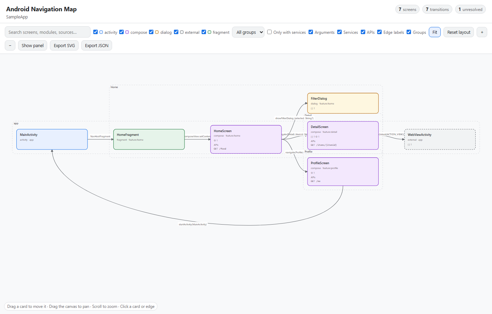
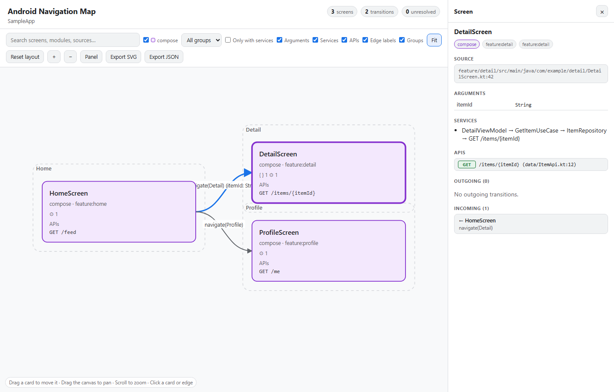

# Android Navigation Map

This skill analyzes and documents navigation in Android applications. See [SKILL.md](SKILL.md) for the complete instructions.

## Features

- Detects navigation through Activities, Intents, Fragments, the XML Navigation Component, Compose Navigation 2 and 3, and hybrid flows.
- Generates Mermaid diagrams, a self-contained offline HTML viewer, or both.
- Optionally maps arguments, services, and HTTP APIs consumed by each screen. APIs include the method, path, and source, and are listed only when the actual call can be traced from the screen to its implementation.
- Reports unresolved transitions and calls instead of inventing destinations or endpoints.
- Searches and filters screens by type or group, inspects screen details, and toggles the display of arguments, services, and APIs.
- In the HTML viewer, cards can be dragged with a mouse or touch. Connections, labels, and groups follow the cards; **Reset layout** restores the automatic layout.
- Exports the graph as SVG and JSON. Updated card positions are reflected in the SVG and persist while the HTML page remains open.
- Analyzes source code without an emulator, device, or build.

## Installation

From the root of this repository, copy the complete `android-navigation-map` directory to the global skill directory of the agent you want to use. These PowerShell commands create the destination if needed and replace the existing copy of this skill:

```powershell
# Shared: Copilot, Codex, Cursor, OpenCode, and Gemini CLI
New-Item -ItemType Directory -Force "$HOME\.agents\skills" | Out-Null
Copy-Item -Recurse -Force .\android-navigation-map "$HOME\.agents\skills\"

# Claude Code
New-Item -ItemType Directory -Force "$HOME\.claude\skills" | Out-Null
Copy-Item -Recurse -Force .\android-navigation-map "$HOME\.claude\skills\"

# Android Studio
New-Item -ItemType Directory -Force "$HOME\.android-studio\skills" | Out-Null
Copy-Item -Recurse -Force .\android-navigation-map "$HOME\.android-studio\skills\"

# Antigravity
New-Item -ItemType Directory -Force "$HOME\.gemini\config\skills" | Out-Null
Copy-Item -Recurse -Force .\android-navigation-map "$HOME\.gemini\config\skills\"

# Cline
New-Item -ItemType Directory -Force "$HOME\.cline\skills" | Out-Null
Copy-Item -Recurse -Force .\android-navigation-map "$HOME\.cline\skills\"
```

For project-level installation, use the agent's project skill directory—for example, `<project-root>\.agents\skills\` for Copilot, Codex, Cursor, OpenCode, and Gemini CLI, or `<project-root>\.claude\skills\` for Claude Code—and copy the skill directory there. Restart the agent or refresh its skill list if the skill does not appear immediately.

## Screenshots

Sample graph showing screens, transitions, and per-screen APIs directly on the cards:



Selecting a screen shows its arguments, service chain, and endpoint evidence:



---

# Android Navigation Map (Español)

Skill para analizar y documentar la navegación de una aplicación Android. Consulta las instrucciones completas en [SKILL.md](SKILL.md).

## Características

- Detecta navegación con Activities, Intents, Fragments, XML Navigation Component, Compose Navigation 2 y 3, y flujos híbridos.
- Genera diagramas Mermaid, un visor HTML autónomo que funciona sin conexión, o ambos.
- Opcionalmente incluye argumentos, servicios y APIs HTTP consumidas por cada pantalla. Las APIs muestran método, ruta y fuente; solo se agregan cuando se puede seguir la llamada real desde la pantalla hasta la implementación.
- Señala transiciones y llamadas no resueltas en lugar de inventar destinos o endpoints.
- Permite buscar y filtrar pantallas por tipo o grupo, inspeccionar sus detalles, y controlar la visualización de argumentos, servicios y APIs.
- En el visor HTML, las tarjetas se pueden arrastrar con ratón o toque. Las conexiones, etiquetas y grupos se actualizan con ellas; **Reset layout** restaura el diseño automático.
- Exporta el grafo a SVG y JSON. Las posiciones modificadas se reflejan en el SVG y duran mientras el HTML permanezca abierto.
- Analiza el código fuente sin requerir un emulador, dispositivo ni compilación.

## Instalación

Desde la raíz de este repositorio, copia la carpeta completa `android-navigation-map` al directorio global del agente que quieras usar. Estos comandos de PowerShell crean el destino si hace falta y reemplazan la copia existente de esta skill:

```powershell
# Compartido: Copilot, Codex, Cursor, OpenCode y Gemini CLI
New-Item -ItemType Directory -Force "$HOME\.agents\skills" | Out-Null
Copy-Item -Recurse -Force .\android-navigation-map "$HOME\.agents\skills\"

# Claude Code
New-Item -ItemType Directory -Force "$HOME\.claude\skills" | Out-Null
Copy-Item -Recurse -Force .\android-navigation-map "$HOME\.claude\skills\"

# Android Studio
New-Item -ItemType Directory -Force "$HOME\.android-studio\skills" | Out-Null
Copy-Item -Recurse -Force .\android-navigation-map "$HOME\.android-studio\skills\"

# Antigravity
New-Item -ItemType Directory -Force "$HOME\.gemini\config\skills" | Out-Null
Copy-Item -Recurse -Force .\android-navigation-map "$HOME\.gemini\config\skills\"

# Cline
New-Item -ItemType Directory -Force "$HOME\.cline\skills" | Out-Null
Copy-Item -Recurse -Force .\android-navigation-map "$HOME\.cline\skills\"
```

Para instalarla solo en un proyecto, usa sus ubicaciones de skills —por ejemplo, `<raíz-del-proyecto>\.agents\skills\` para Copilot, Codex, Cursor, OpenCode y Gemini CLI, o `<raíz-del-proyecto>\.claude\skills\` para Claude Code— y copia allí la carpeta. Reinicia el agente o actualiza su lista de skills si no aparece inmediatamente.

## Capturas

Mapa de ejemplo con sus pantallas, transiciones y APIs directamente en las tarjetas:


Al seleccionar una pantalla se muestran sus argumentos, la cadena de servicios y la evidencia del endpoint:


