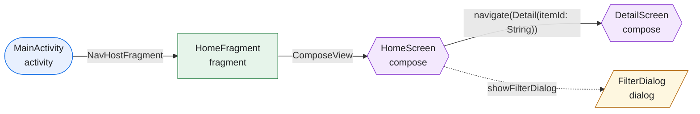

# Android Navigation Map

Build a static map of how an Android app moves between Activities, Fragments, and Compose screens. Render it as Mermaid, a self-contained offline HTML page, or both. Optionally show the arguments passed between screens and the service chain each screen consumes.

## Overview

- Detects XML Navigation Component, Activities and Intents, Compose Navigation 2 (string and type-safe routes), Compose Navigation 3 (`NavKey`), and hybrid apps.
- Works from source only: no emulator, device, or build.
- Uses one intermediate graph for both renderers.
- Never invents transitions. Unresolved navigation is marked and listed.

## Workflow

### 1. Inspect the project quietly

Read:

- `settings.gradle` or `settings.gradle.kts` for modules.
- Module `build.gradle` or `build.gradle.kts` and `gradle/libs.versions.toml` for navigation, dependency injection, networking, and database libraries.
- `AndroidManifest.xml` for Activities, the launcher, intent filters, `parentActivityName`, and deep links.
- `res/navigation/*.xml` for XML navigation graphs.
- Kotlin/Java sources for Compose hosts, `startActivity`, and ViewModels.

Do not ask which navigation stack the project uses. Detect it.

### 2. Ask the user

Use the agent's structured ask/input tool when available; otherwise ask in the conversation. Use the user's language.

Ask:

1. **Arguments**: "Do you want to see the arguments/parameters passed between screens?" If yes, include navigation arguments only.
2. **Services**: "Do you want to map the services each screen consumes?" If yes, include the full chain and HTTP APIs without asking separately.
3. **Format**: Mermaid, offline HTML, or both. Default to both.
4. **Destination**: where to write the files. Default to `docs/navigation/`. Confirm before overwriting.

If the user already answered a question, confirm it instead of asking again. Do not ask about dialogs, bottom sheets, nested graphs, or deep links; include them when detected and mention them in the summary.

### 3. Detect the graph

Follow [reference/detection.md](reference/detection.md). Record `path:line` for every node and edge.

Minimum coverage:

- XML destinations, actions, arguments, nested graphs, includes, and deep links.
- Activities and explicit or implicit Intents.
- Compose Navigation 2 hosts, destinations, and `navigate` calls.
- Compose Navigation 3 `NavDisplay`, `entry<T>`, and `backStack.add`.
- Hybrid bridges between Activities, Fragments, and Compose.
- Entry points: launcher, deep links, notifications, shortcuts, widgets.

If the project uses Voyager, Decompose, or Compose Destinations, detect it, include what can be resolved, and state that support is best-effort.

### 4. Build the intermediate graph

Use this model as the single source of truth for both renderers.

```json
{
  "project": { "name": "MyApp", "modules": ["app", "feature:detail"] },
  "nodes": [
    {
      "id": "compose:com.example.detail.DetailScreen",
      "type": "compose",
      "label": "DetailScreen",
      "module": "feature:detail",
      "source": "feature/detail/src/main/kotlin/com/example/detail/DetailScreen.kt:42",
      "args": [{ "name": "itemId", "type": "String" }],
      "services": ["DetailViewModel → GetItemUseCase → ItemRepository → GET /items/{itemId}"],
      "apis": [{ "method": "GET", "path": "/items/{itemId}", "source": "data/ItemApi.kt:12" }],
      "group": "feature:detail"
    }
  ],
  "edges": [
    {
      "from": "compose:com.example.home.HomeScreen",
      "to": "compose:com.example.detail.DetailScreen",
      "kind": "navigate",
      "label": "navigate(Detail(itemId))",
      "args": [{ "name": "itemId", "type": "String" }],
      "confidence": "explicit",
      "source": "feature/home/src/main/kotlin/com/example/home/HomeScreen.kt:88"
    }
  ],
  "groups": [{ "id": "feature:detail", "label": "Detail" }],
  "unresolved": [
    { "reason": "navigate(routeVariable)", "source": "feature/home/src/main/kotlin/com/example/home/HomeScreen.kt:120" }
  ]
}
```

Rules:

- Node types: `activity`, `fragment`, `compose`, `dialog`, `bottomSheet`, `navGraph`, `external`.
- Edge kinds: `action`, `navigate`, `intent`, `deepLink`, `include`, `unknown`.
- Confidence: `explicit`, `inferred`, `unknown`.
- `source` is always `path:line`, relative to the project root, using forward slashes.
- Set `entry: true` on launcher, deep-link, notification, shortcut, and widget entry points. This keeps them visible when the graph contains cycles.
- Use stable IDs: `activity:com.example.MainActivity`, `fragment:com.example.HomeFragment`, `compose:com.example.DetailScreen`.
- Merge duplicate nodes and keep every distinct edge.
- Put anything that cannot be resolved in `unresolved`. Never guess a destination.
- `apis` is optional and contains HTTP method, path, and endpoint declaration or call `source` (`path:line`). Omit it or use an empty array when no HTTP endpoints are resolved. Existing graphs without it remain valid.

### 5. Optional: arguments

Only when the user said yes.

- XML: `<argument android:name="..." app:argType="..." android:defaultValue="..." />` and Safe Args call sites.
- Intents: `putExtra("key", value)` matched with `getStringExtra`, `getIntExtra`, and similar.
- Compose Navigation 2: properties of `@Serializable` route classes and `{placeholder}` segments in string routes.
- Compose Navigation 3: properties of the `NavKey` data class.
- Show `name: Type` in edge labels and in the node or edge detail panel. Omit default values unless they disambiguate.
- Do not include shared ViewModel state or deep-link URI parameters unless the user explicitly asks for them.

### 6. Optional: services

Only when the user said yes. Include HTTP APIs automatically, without a separate question. Follow [reference/services.md](reference/services.md).

Resolve the chain for each screen:

1. Screen → ViewModel (`viewModel()`, `hiltViewModel()`, `koinViewModel()`, `by viewModels()`, `ViewModelProvider`).
2. ViewModel → constructor dependencies (use cases and repositories).
3. Use case or repository → Retrofit or Ktor endpoint, Apollo operation, Room DAO, Firebase call, or SDK.
4. Resolve interfaces to implementations through Hilt, Koin, or manual wiring.

Record one readable string per chain, for example:

`DetailViewModel → GetItemUseCase → ItemRepository → GET /items/{itemId}`

If a link cannot be resolved statically, keep the known part and append `→ ?`, then add an entry to `unresolved`. Do not invent implementations.

Trace actual screen-triggered calls through the ViewModel, use case, repository, DI binding and implementation to Retrofit/Ktor. Populate `apis` only for endpoints supported by that call chain, with method, path and source evidence; injection alone is not a call. Deduplicate identical endpoints per screen. Record ambiguous bindings, dynamic methods or paths and untraceable calls in `unresolved`, without assigning speculative endpoints. Keep Room, Firebase, Apollo and SDK operations in `services`; do not label them HTTP APIs unless their HTTP method and path are independently established.

### 7. Render Mermaid

- Default to `flowchart LR`; use `TB` when the graph is deep and narrow.
- Use `subgraph` per module or feature when there are more than about 20 nodes.
- Style by node type and include a legend.
- Use solid arrows for explicit navigation and `-.->` for deep links, implicit intents, and unknown transitions.
- Escape labels: wrap labels containing parentheses, colons, or quotes in double quotes; use `<br/>` for line breaks.
- Put arguments on the edge label when enabled; keep them short.
- When services are enabled, include a per-screen API list after the diagram with each resolved HTTP method and path; identify screens without resolved HTTP APIs. Mermaid is static and does not support card dragging.
- Add a short section after the diagram for unresolved transitions and unreachable destinations.
- Verify the Mermaid syntax before writing the file.

Example:



### 8. Render offline HTML

1. Copy [assets/diagram.html](assets/diagram.html) to the destination as `navigation.html`. Copy the file verbatim; do not retype, reformat, or partially rewrite the template.
2. Replace only the contents of the `<script type="application/json" id="nav-graph">` element with the generated graph JSON. Keep the element, its `type`, and the rest of the file unchanged.
3. The page reads the project name from the JSON; update the document title only if needed.
4. Do not add CDN links, external fonts, or remote images. The file must open offline.
5. If the graph has more than about 30 nodes, split it by feature or module into multiple HTML files plus an index page, or tell the user to use the group filter.
6. Open the file and check that nodes, edges, filters, and the detail panel work. The header must show the project name, not `Loading…`. If it still shows `Loading…` or the fallback error, the page script failed; see [Troubleshooting](#html-stays-on-loading).
7. If Node is available, extract the last `<script>` block and run `node --check` on it before reporting success.
8. Do not hand-edit the renderer to adjust layout or styles. Change the graph JSON, or update the template in the skill and copy it again.

The template supports pan and zoom, card dragging, click-to-inspect, search, type and group filters, argument, service and card API toggles, a collapsible details panel, SVG export, and JSON export. Dragged positions survive filters and controls until reload; Reset layout restores the automatic layout. SVG export includes the current positions.

### 9. Verify

- [ ] Every node and edge has a `source` with `path:line`.
- [ ] Every edge points to an existing node; unresolved transitions are in `unresolved`.
- [ ] Unreachable destinations are listed.
- [ ] Arguments and services match the user's choices; each HTTP API has a traced call chain and source evidence, with ambiguities in `unresolved`.
- [ ] Mermaid labels are escaped and the diagram renders.
- [ ] The HTML has no external URLs and opens offline.
- [ ] The HTML header shows the project name, not `Loading…`, and the browser console has no errors.
- [ ] The HTML page script is identical to the template; only the JSON payload differs.
- [ ] The output path was confirmed and no file was overwritten without permission.
- [ ] The summary includes counts, formats, and limitations.

### 10. Report

Reply in the user's language with:

- Detected stack and modules.
- Number of screens, transitions, and unresolved items.
- Files written and their paths.
- A short list of assumptions and limitations.
- The most important unresolved transition, if any.

## Troubleshooting

### HTML stays on "Loading…"

The page script did not finish. Check, in this order:

1. Open the browser console. A syntax error usually names the line and the offending token.
2. Confirm the `<script type="application/json" id="nav-graph">` payload is valid JSON. Common causes are a trailing comma, a missing quote, or an unescaped `</script>` inside a string.
3. Confirm the renderer script was copied unchanged from the template. Do not retype it or edit it while replacing the graph. Copy the template again and replace only the JSON payload.
4. If Node is available, extract the last `<script>` block and run `node --check` on it.
5. Reopen the page. The header must show the project name, not `Loading…`.

The template includes a fallback message that appears when the renderer does not finish, so an endless `Loading…` usually means the fallback script was removed or the file was rewritten.

## Additional resources

- [reference/detection.md](reference/detection.md): exact patterns per framework and edge cases.
- [reference/services.md](reference/services.md): screen-to-service resolution.
- [examples.md](examples.md): XML, Compose Navigation 2/3, hybrid, and sample outputs.
