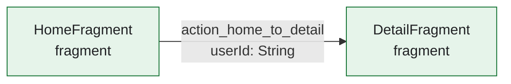
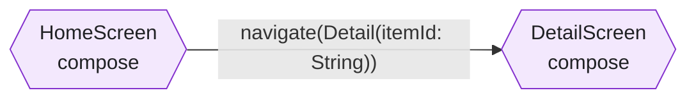
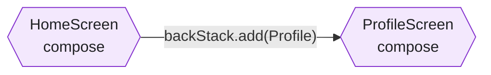
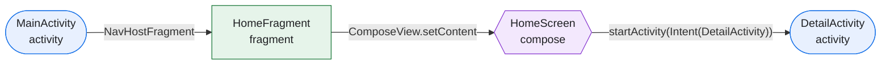
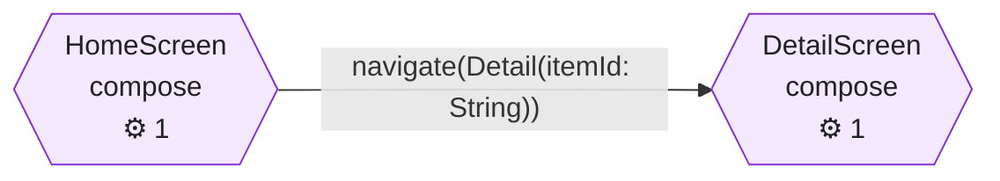

# Navigation Map Examples

## Example 1: XML Navigation Component

Input:

```xml
<navigation app:startDestination="@id/homeFragment">
    <fragment android:id="@+id/homeFragment" android:name="com.example.HomeFragment">
        <action android:id="@+id/action_home_to_detail" app:destination="@id/detailFragment" />
        <argument android:name="userId" app:argType="string" />
    </fragment>
    <fragment android:id="@+id/detailFragment" android:name="com.example.DetailFragment" />
</navigation>
```

Output:



## Example 2: Compose Navigation 2 with type-safe routes

Input:

```kotlin
@Serializable data class Home(val tab: String = "feed")
@Serializable data class Detail(val itemId: String)

NavHost(navController, startDestination = Home()) {
    composable<Home> {
        HomeScreen(onDetail = { id -> navController.navigate(Detail(id)) })
    }
    composable<Detail> { entry ->
        DetailScreen(entry.toRoute<Detail>())
    }
}
```

Output:



Graph fragment:

```json
{
  "nodes": [
    { "id": "compose:com.example.HomeScreen", "type": "compose", "label": "HomeScreen", "args": [{ "name": "tab", "type": "String" }] },
    { "id": "compose:com.example.DetailScreen", "type": "compose", "label": "DetailScreen", "args": [{ "name": "itemId", "type": "String" }] }
  ],
  "edges": [
    {
      "from": "compose:com.example.HomeScreen",
      "to": "compose:com.example.DetailScreen",
      "kind": "navigate",
      "label": "navigate(Detail(itemId))",
      "args": [{ "name": "itemId", "type": "String" }],
      "confidence": "explicit"
    }
  ]
}
```

## Example 3: Compose Navigation 3

Input:

```kotlin
val backStack = rememberNavBackStack(Home)

NavDisplay(
    backStack = backStack,
    onBack = { backStack.removeLastOrNull() },
    entryProvider = entryProvider {
        entry<Home> {
            HomeScreen(onProfile = { backStack.add(Profile) })
        }
        entry<Profile> {
            ProfileScreen(onBack = { backStack.removeLastOrNull() })
        }
    }
)
```

Output:



`Profile` is a `NavKey`. If it has properties, treat them as navigation arguments.

## Example 4: Hybrid app

Flow: Activity hosts a Fragment, the Fragment hosts Compose, and Compose opens another Activity.



## Example 5: Arguments and services



Service table:

| Screen | Chain |
| --- | --- |
| `HomeScreen` | `HomeViewModel → GetFeedUseCase → FeedRepository → GET /feed` |
| `DetailScreen` | `DetailViewModel → GetItemUseCase → ItemRepository → GET /items/{itemId}` |

APIs by screen:

- `HomeScreen`: `GET /feed`
- `DetailScreen`: `GET /items/{itemId}`

The corresponding node data records the endpoint evidence:

```json
{
  "services": ["DetailViewModel → GetItemUseCase → ItemRepository → GET /items/{itemId}"],
  "apis": [{ "method": "GET", "path": "/items/{itemId}", "source": "data/ItemApi.kt:12" }]
}
```

In HTML, APIs appear in the card and below Services in the detail panel. The APIs checkbox hides them in cards only. Drag cards to reposition them; Reset layout restores automatic positions. Mermaid remains static.

## Example 6: Unresolved navigation

Input:

```kotlin
val route = if (featureEnabled) "detail/$id" else "legacy/$id"
navController.navigate(route)
```

Output:

- A dashed edge to `unknown` or no edge, depending on what can be resolved.
- An entry in `unresolved`:

```json
{
  "reason": "navigate(route) uses a runtime feature flag: detail/$id or legacy/$id",
  "source": "feature/home/src/main/kotlin/com/example/home/HomeScreen.kt:120"
}
```

Do not invent two edges. Report the ambiguity.

## Example 7: Large graph

For a graph with more than about 30 nodes:

1. Group nodes by module or feature.
2. Render one Mermaid diagram per group, plus an index diagram that shows only the groups.
3. For HTML, generate one page per group and an index page, or use the group filter in the template.
4. Keep the full JSON as the source of truth; the split pages are views of the same data.

## Example 8: Using the HTML template

1. Copy `assets/diagram.html` to `docs/navigation/navigation.html` verbatim. Do not retype or reformat the template.
2. Open it in an editor and find:

```html
<script type="application/json" id="nav-graph">
{ ... sample data ... }
</script>
```

3. Replace only the sample JSON with the generated graph. Keep the `<script>` element, its `type`, and the rest of the file unchanged.
4. Open the file in a browser. The header must show the project name, not `Loading…`. It works offline; no CDN or external assets are required.
5. Check:
   - Nodes are grouped by feature.
   - Clicking a node shows arguments, services, APIs, and incoming/outgoing edges.
   - Search and type filters work.
   - The arguments, services, and APIs toggles hide the corresponding card content.
   - Dragged cards retain their positions after toggles or filters; edges and groups follow, Reset layout restores positions, and the exported SVG reflects the current layout.
   - The Panel button hides the details panel and refits the canvas.
   - Export SVG and Export JSON produce files.
   - The browser console has no errors.
